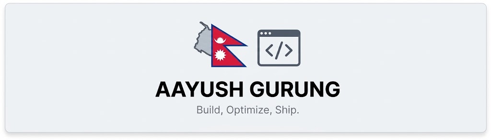

  <!-- Put your cover image at: aayush-gurung-tech/assets/cover.png -->
  

# 💫 Hi 👋, I'm Aayush Gurung
### A passionate Web Developer from Nepal 🇳🇵

---

- 🔭 **I’m currently working on:** Web Development Projects
- 🌱 **I’m currently learning:** Full Stack Development (React, Node.js)
- 👯 **I’m looking to collaborate on:** Open Source Web Projects
- 🤔 **I’m looking for help with:** Advanced Backend Development
- 💬 **Ask me about:** Web Development, JavaScript, React
- 📫 **How to reach me:** nabin.laghey.official@gmail.com
- ⚡ **Fun fact:** I Love Tech and Tech Loves Me

## 🌐 Socials

&nbsp;&nbsp;&nbsp;

# 💻 Tech Stack:
                
# 📊 GitHub Stats

## 📌 Profile Summary

---

